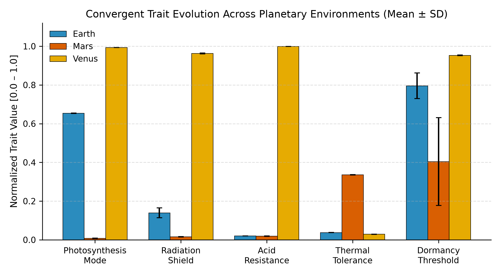

# 🪐 ASTROBIO-EVO-SIM
### Emergent Niche Bifurcation & Convergent Trait Evolution Under Planetary Constraints


> *"I randomly got this idea like 'how about building an Earth simulator,' then improvised it into other planets, their atmospheres, and how life would actually survive there. Thank you for reading this small-ass rant."*  
> — How this started.  
> **How it's going:** 90 multi-seed runs, 120 sensitivity sweeps, Kruskal–Wallis $p < 0.0001$, and a 4-page IEEE research paper.

---

## 🔬 What Is This?

`astrobio-evo-sim` is a deterministic, headless, vectorized agent-based evolutionary simulator built in Python and NumPy (Structure-of-Arrays layout, zero Python loops over agents). 

Instead of hardcoding alien species, **Earth, Mars, and Venus all start with the exact same uniform, clueless population** spread evenly across three vertical layers (**Subsurface, Surface, Airborne**) and random traits in $[0, 1]$. Every organism obeys a strict energy-conservation law with metabolic upkeep costs and conditional spore dormancy.

Then we hit run for **20,000 hourly ticks** across **30 random seeds per planet** and let natural selection do the rest.

---

## 📊 Key Findings ($n = 30$ Seeds / Planet)

| Planet | Final Population | Vertical Habitat (Sub / Surf / Air) | Evolved Strategy |
| :--- | :---: | :---: | :--- |
| **Earth** *(Control)* | `22,390 ± 44` | `33.9% / 50.2% / 15.9%` | Multi-niche ecosystem across all 3 layers; sheds unnecessary armor. |
| **Mars** | `6,333 ± 16` | `100.0% / 0.0% / 0.0%` | Pure subsurface chemoautotrophs (`Metab: 0.008`), exact cold calibration (`Therm: 0.336`), and **neutral-trait genetic drift** in dormancy (`SD: 0.227`). |
| **Venus** | `8,208 ± 185` | `0.0% / 0.0% / 100.0%` | 100% airborne photosynthetic extremophiles (`Acid: 0.999`) that unexpectedly evolved **max radiation shielding (`0.963`)** to survive 48-hour super-rotation nights in spore state. |



*   **Complete Surface Purge:** Both Mars and Venus drove surface life to `0.0%` (the *only* non-significant pairwise Mann–Whitney $U$ test in the study, $p = 1.0000$) and split in opposite vertical directions.
*   **Extinction Cliffs:** Sensitivity sweeps revealed linear thermodynamic tracking on Mars until hitting the biological ceiling at $-80^\circ\text{C}$ (collapsing at $-100^\circ\text{C}$), and a razor-sharp extinction cliff on Venus between 144-hour and 192-hour diurnal cycles.

---

## 🚀 Quickstart & Reproduction

Runs comfortably on consumer hardware (tested on an 8GB RAM laptop).

### 1. Setup
```bash
git clone [https://github.com/Parasyte23/ASTROBIO-EVO-SIM.git](https://github.com/Parasyte23/ASTROBIO-EVO-SIM.git)
cd ASTROBIO-EVO-SIM
python -m venv .venv
# Windows: .venv\Scripts\activate | Linux/Mac: source .venv/bin/activate
pip install numpy pandas scipy matplotlib pytest
```

### 2. Verify Determinism & Bounds
```bash
python -m pytest -v
```

### 3. Run Experiments & Generate Paper Figures
```bash
# Quick single-seed test (Earth, Mars, Venus)
python -m experiments.run_single

# Full 30-seed research batch (90 runs, parallelized)
python -m experiments.run_batch --seeds 30

# Sensitivity sweeps (Mars temperature & Venus super-rotation)
python -m experiments.run_sensitivity

# Statistical tables (Kruskal-Wallis & Bonferroni Mann-Whitney U)
python -m analysis.stats

# Generate 300-DPI PNG + vector PDF figures
python -m analysis.plot_figures
```

---

## 📁 Repository Structure

```text
astrobio-evo-sim/
├── configs/
│   ├── planets.json          # NASA/ESA planetary constants & 3-layer profiles
│   └── sim_defaults.json     # Energy budget, upkeep weights, mutation rates
├── src/
│   ├── environment.py        # Diurnal cycles & vectorized layer lookups
│   ├── population.py         # Pre-allocated NumPy SoA memory pool
│   ├── engine.py             # Vectorized energy conservation & dormancy loop
│   └── logger.py             # Buffered CSV telemetry writer
├── experiments/
│   ├── run_single.py         # Single-seed CLI runner
│   ├── run_batch.py          # Multiprocessing 30-seed batch runner
│   └── run_sensitivity.py    # Parameter sweeps + Figure 4 generator
├── analysis/
│   ├── stats.py              # Descriptive stats & non-parametric tests
│   └── plot_figures.py       # Publication-ready Matplotlib figures (Figs 1–3)
├── tests/
│   └── test_engine.py        # 10 pytest cases (bit-for-bit determinism, NaNs, bounds)
├── data/figures/             # Generated high-DPI plots & CSV tables
└── paper.tex                 # Complete 4-page IEEE LaTeX manuscript
```

---

## 📄 Citation

If you use this engine or build on the planetary configs, feel free to cite the paper:

```bibtex
@misc{choudhary2026astrobio,
  author       = {Chetan Choudhary},
  title        = {Emergent Niche Bifurcation and Convergent Trait Evolution Under Planetary Environmental Constraints: A Vectorized Agent-Based Astrobiology Simulation},
  year         = {2026},
  howpublished = {\url{[https://github.com/Parasyte23/ASTROBIO-EVO-SIM](https://github.com/Parasyte23/ASTROBIO-EVO-SIM)}}
}
```